# OldAiLife

**Pequeñas reglas. Mundos inesperados.**

Un laboratorio local de vida artificial con **20 simulaciones interactivas**, estética oscura de finales de los noventa y principios de los dos mil, y muchas posibilidades para experimentar.

[English](README.md) · **Español**

[](https://github.com/FernandoOleaDev/OldAiLife/actions/workflows/ci.yml)
[](LICENSE)
[](#galería-de-modelos)

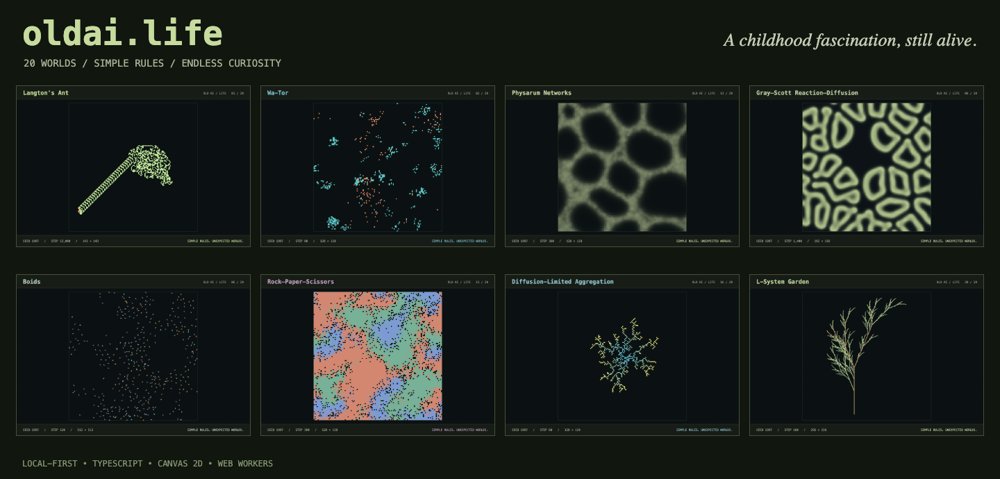

[Por qué existe](#por-qué-existe) · [Arranque rápido](#arranque-rápido) · [Galería](#galería-de-modelos) · [Controles](#usar-el-laboratorio) · [Desarrollo](#desarrollo) · [Créditos](#créditos-y-referencias)

## Por qué existe

Mucho antes del boom actual de la IA, este tipo de inteligencia artificial me fascinaba desde pequeño: hormigas que seguían reglas simples, depredadores y presas compartiendo un mundo, y pequeños sistemas que parecían cobrar vida por sí solos.

OldAiLife es mi forma de volver a esa curiosidad. Elige un mundo, cambia una regla, acelera el tiempo y observa qué sucede. A veces aparece el orden. A veces todo colapsa. Las dos cosas merecen explorarse.

— **Fernando Olea**

La colección reúne vida artificial, autómatas celulares, modelos basados en agentes y otros sistemas emergentes. Combina clásicos antiguos con incorporaciones más recientes, como Lenia y Physarum. Las simulaciones ejecutan reglas explícitas en local; no usan modelos de lenguaje ni necesitan un servicio de IA.

## Qué puedes hacer

- Explorar **20 mundos independientes**, organizados en seis familias.
- Partir de ejemplos preparados, cambiar reglas e intervenir con pinceles específicos.
- Pausar, avanzar paso a paso, reiniciar y acelerar; comparar velocidad solicitada y real.
- Seguir poblaciones y otras medidas mediante gráficas en directo.
- Guardar localmente, exportar estados JSON completos, importarlos después y capturar imágenes PNG.
- Repetir experimentos con semillas aleatorias reproducibles.
- Usar zoom, desplazamiento, cuadrícula, pantalla completa y textura CRT opcional.

**Todo ocurre en local:** sin cuentas, claves de API, seguimiento, fuentes remotas ni dependencias de CDN durante el uso. La primera instalación necesita Internet; después basta con un servidor local. Las referencias solo se abren al pulsarlas.

> **Idioma:** la interfaz de la aplicación está actualmente en **español**. El README se ofrece en inglés y español; los enlaces de idioma cambian la documentación, no la interfaz de la web.

<details>
<summary>Ver la interfaz de la aplicación</summary>

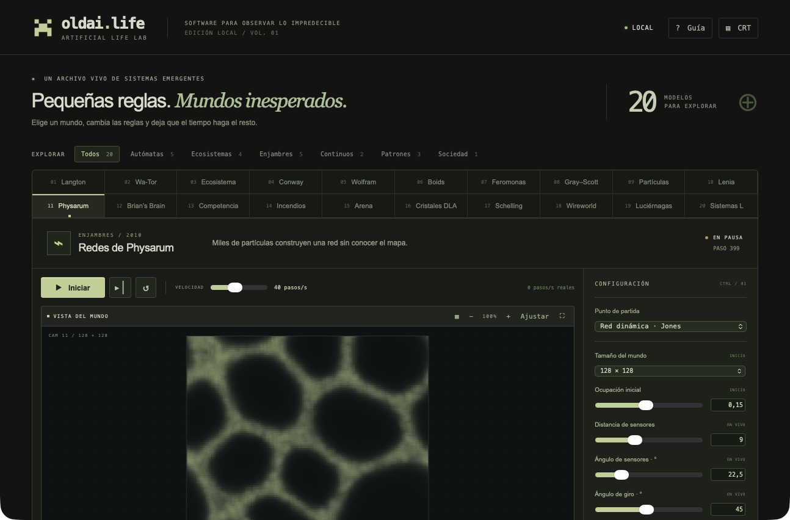

</details>

## Arranque rápido

Instala **Node.js 22.12 o posterior** y npm:

```sh
git clone https://github.com/FernandoOleaDev/OldAiLife.git
cd OldAiLife
npm ci
npm run dev
```

Abre **[http://127.0.0.1:5174/](http://127.0.0.1:5174/)**. Si el puerto está ocupado, usa la dirección local que indique Vite. El servidor escucha en `127.0.0.1`.

En macOS también puedes hacer doble clic en [`Iniciar.command`](Iniciar.command) después de instalar Node.js. En otros sistemas, utiliza los comandos anteriores.

Para compilar y servir la versión de producción en local:

```sh
npm run build
npm run preview
```

La vista previa suele estar en **http://127.0.0.1:4173/**. Mantén la terminal abierta mientras usas la web. El ordenador suspendido no sigue simulando.

## Galería de modelos

Cada imagen muestra un **estado real de la simulación con semilla fija**, dibujado por el mismo renderizador Canvas de la aplicación. Los rótulos en inglés son pies de documentación, no una traducción de la interfaz. Pulsa una imagen para ver el PNG completo. Se registran los [parámetros, pasos y huellas](docs/images/manifest.json); `npm run screenshots` regenera la galería.

<table>
<tr>
<td width="50%" valign="top">
<h3>01 · Hormiga de Langton</h3>
<a href="docs/images/langton.png">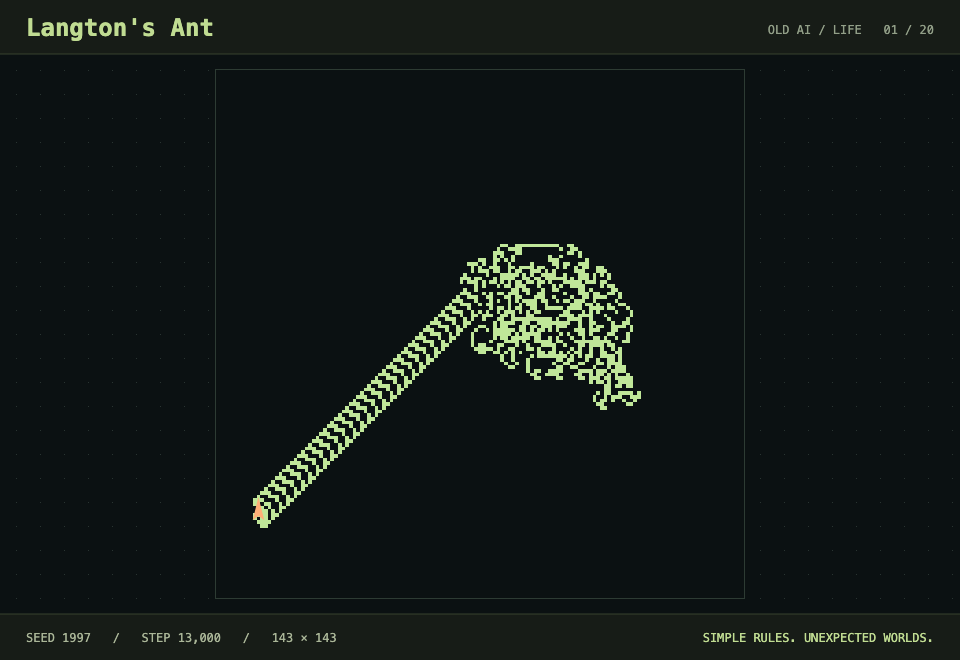</a>
<p>Un caminante lee una celda, gira, cambia su color y avanza. Una regla mínima puede acabar formando una larga autopista repetitiva.</p>
<p><strong>Prueba:</strong> Cambia la secuencia L/R o deja que varias hormigas compartan el tablero.</p>
<p><a href="https://www.mat-unab.cl/~hellouin/Articles/Turmites.pdf">Referencia ↗</a></p>
</td>
<td width="50%" valign="top">
<h3>02 · Océano Wa-Tor</h3>
<a href="docs/images/wator.png">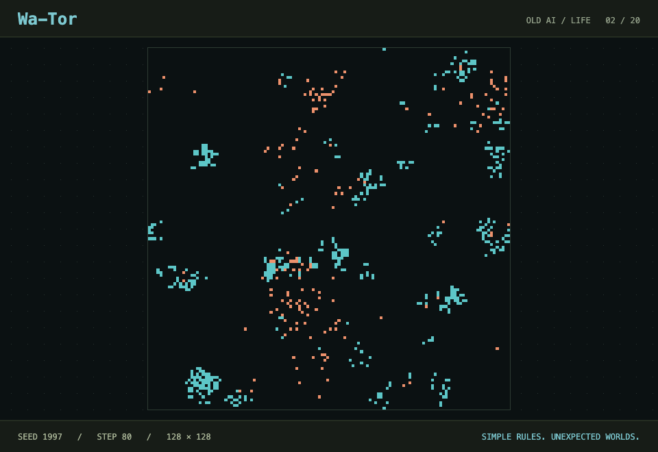</a>
<p>Los peces se reproducen; los tiburones comen peces y mueren si pasan demasiado tiempo sin alimento. Las poblaciones cambian por interacciones locales.</p>
<p><strong>Prueba:</strong> Empieza con un tiburón y cambia los periodos de reproducción y hambre.</p>
<p><a href="https://www.leinweb.com/snackbar/wator/">Referencia ↗</a></p>
</td>
</tr>
<tr>
<td width="50%" valign="top">
<h3>03 · Lobos, ovejas y hierba</h3>
<a href="docs/images/ecosystem.png">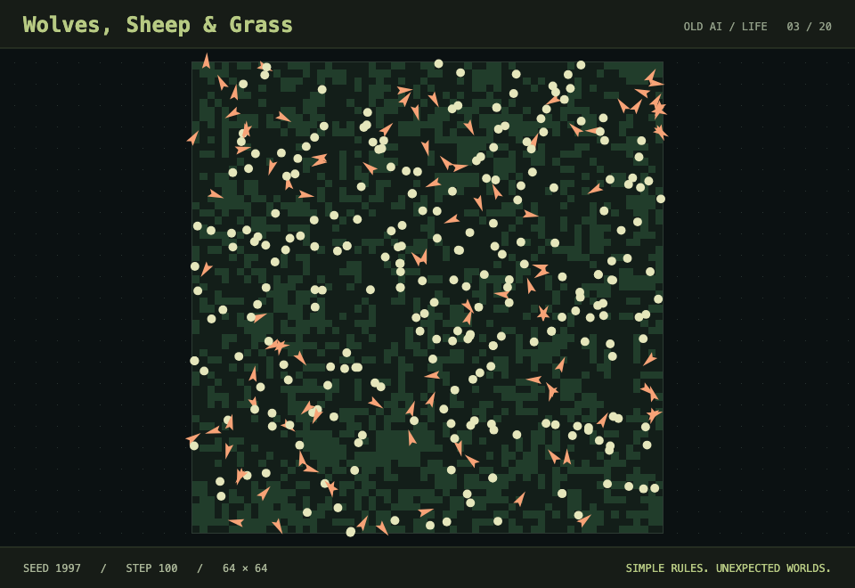</a>
<p>Un ecosistema basado en energía añade un recurso renovable: la hierba. Las ovejas comen hierba, los lobos comen ovejas y reproducirse reparte la energía.</p>
<p><strong>Prueba:</strong> Cambia el rebrote de la hierba y observa si sobreviven ambas poblaciones.</p>
<p><a href="https://ccl.netlogo.org/netlogo/models/WolfSheepPredation">Referencia ↗</a></p>
</td>
<td width="50%" valign="top">
<h3>04 · Juego de la vida de Conway</h3>
<a href="docs/images/life.png">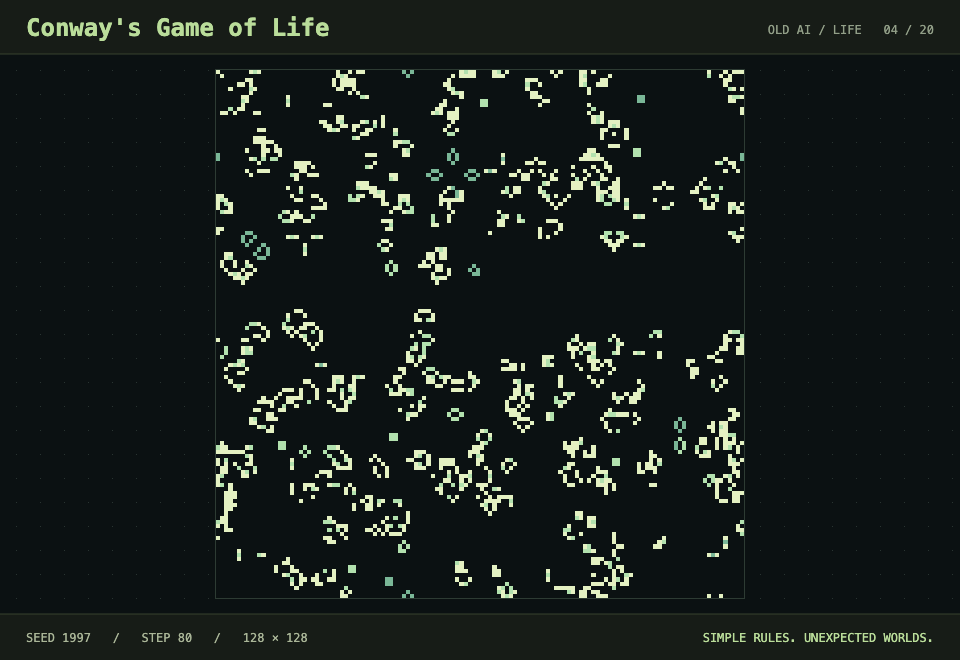</a>
<p>Las células nacen y sobreviven según sus ocho vecinas. La actualización simultánea produce figuras estables, osciladores y patrones viajeros.</p>
<p><strong>Prueba:</strong> Lanza un cañón de Gosper y después explora HighLife o Seeds.</p>
<p><a href="https://ccl.northwestern.edu/netlogo/models/Life">Referencia ↗</a></p>
</td>
</tr>
<tr>
<td width="50%" valign="top">
<h3>05 · Autómatas elementales de Wolfram</h3>
<a href="docs/images/wolfram.png">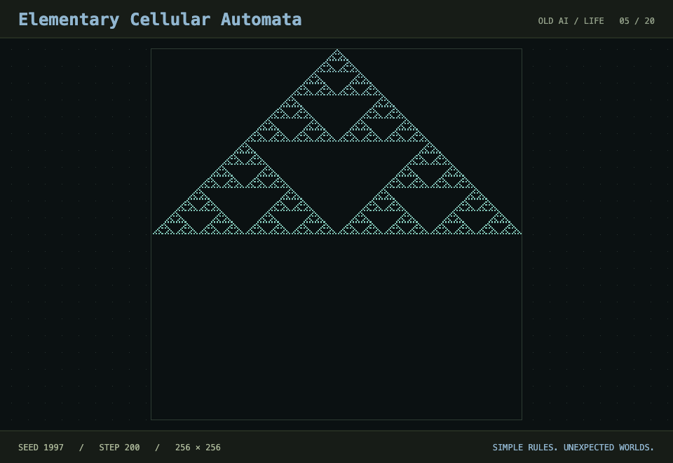</a>
<p>Cada celda de una fila depende de tres celdas de la fila anterior. Ocho decisiones binarias definen una de las 256 reglas posibles.</p>
<p><strong>Prueba:</strong> Compara los triángulos de la regla 90 con las reglas 30, 110 y 184.</p>
<p><a href="https://ccl.northwestern.edu/netlogo/models/CA1DElementary">Referencia ↗</a></p>
</td>
<td width="50%" valign="top">
<h3>06 · Bandadas · Boids</h3>
<a href="docs/images/boids.png">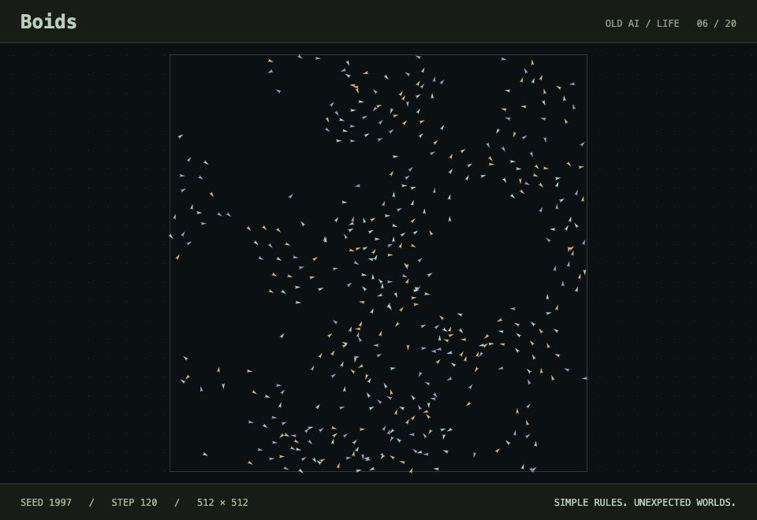</a>
<p>Los agentes se guían por separación, alineación y cohesión. Cada uno reacciona a sus vecinos, pero el conjunto se comporta como una bandada.</p>
<p><strong>Prueba:</strong> Aumenta la alineación, reduce la cohesión o coloca un foco de atracción.</p>
<p><a href="https://www.red3d.com/cwr/boids/">Referencia ↗</a></p>
</td>
</tr>
<tr>
<td width="50%" valign="top">
<h3>07 · Colonia de hormigas</h3>
<a href="docs/images/ants.png">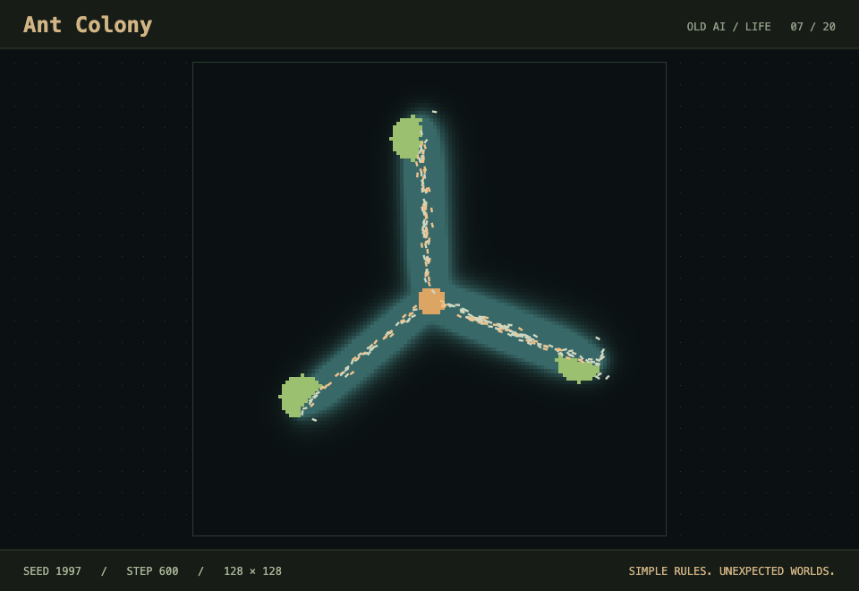</a>
<p>Las exploradoras buscan alimento y dejan feromonas al volver. La difusión y la evaporación permiten que los caminos aparezcan, compitan y desaparezcan.</p>
<p><strong>Prueba:</strong> Mueve la comida, coloca paredes o ajusta la evaporación.</p>
<p><a href="https://ccl.northwestern.edu/netlogo/models/Ants">Referencia ↗</a></p>
</td>
<td width="50%" valign="top">
<h3>08 · Reacción–difusión Gray–Scott</h3>
<a href="docs/images/reaction.png">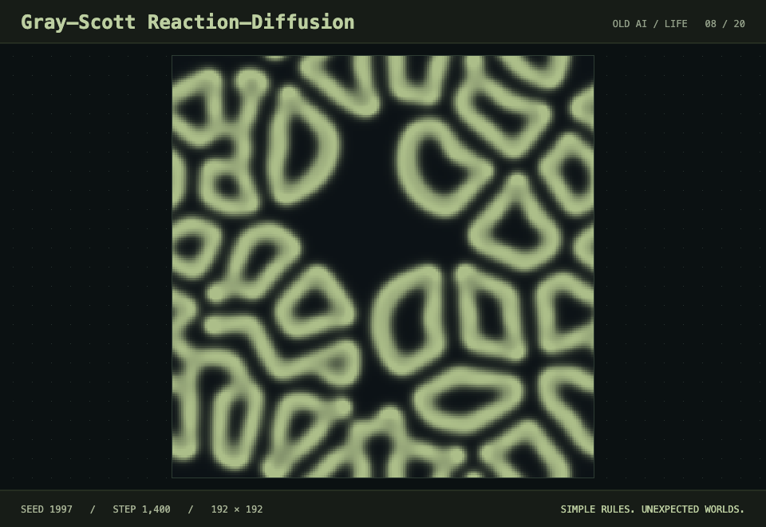</a>
<p>Dos concentraciones químicas reaccionan y se difunden por una cuadrícula. Cambios pequeños pueden transformar manchas en rayas o estructuras móviles.</p>
<p><strong>Prueba:</strong> Cambia de ejemplo y pinta una perturbación en el campo químico.</p>
<p><a href="https://www.karlsims.com/rd.html">Referencia ↗</a></p>
</td>
</tr>
<tr>
<td width="50%" valign="top">
<h3>09 · Particle Life</h3>
<a href="docs/images/particles.png">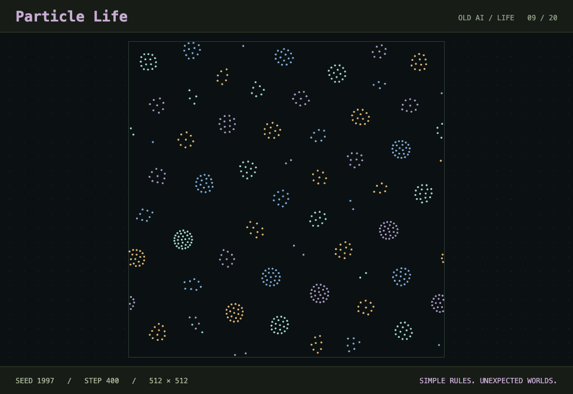</a>
<p>Los tipos de partículas se atraen o repelen mediante una matriz editable. Las relaciones asimétricas producen persecuciones y agrupaciones.</p>
<p><strong>Prueba:</strong> Haz que un tipo persiga a otro que lo repele.</p>
<p><a href="https://particle-life.com/java-framework/accelerators.html">Referencia ↗</a></p>
</td>
<td width="50%" valign="top">
<h3>10 · Lenia</h3>
<a href="docs/images/lenia.png">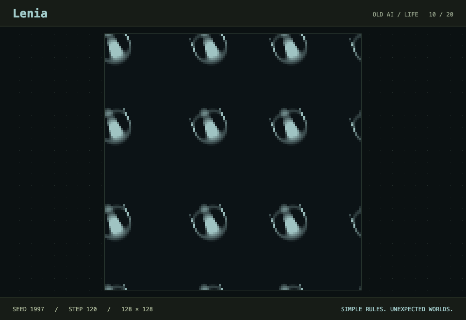</a>
<p>Un autómata celular continuo combina un núcleo de vecindad con una función de crecimiento. Orbium procede del catálogo original de Bert Chan.</p>
<p><strong>Prueba:</strong> Empieza con Orbium o una colonia y modifica los parámetros poco a poco.</p>
<p><a href="https://chakazul.github.io/lenia.html">Referencia ↗</a></p>
</td>
</tr>
<tr>
<td width="50%" valign="top">
<h3>11 · Redes de Physarum</h3>
<a href="docs/images/physarum.png">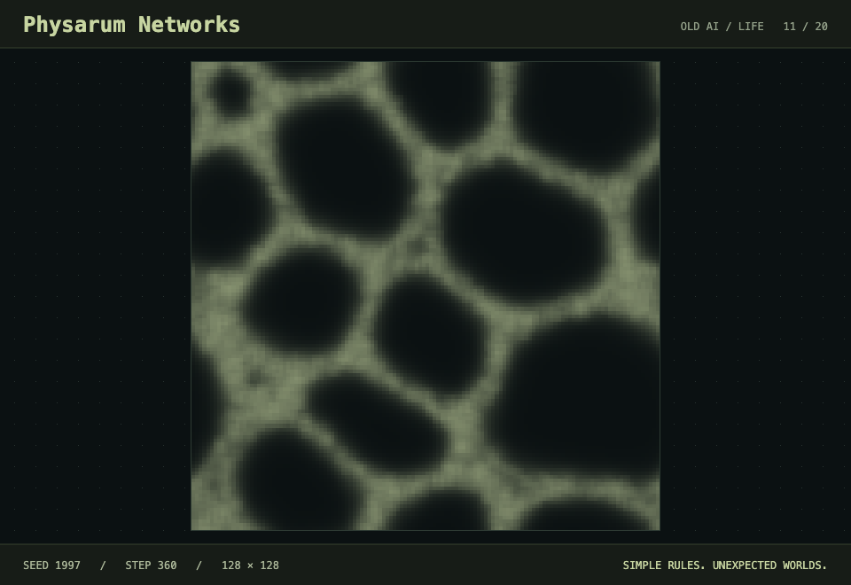</a>
<p>Las partículas detectan y depositan un rastro químico que se difunde. Las decisiones locales y la exclusión por celda forman redes que se reorganizan.</p>
<p><strong>Prueba:</strong> Pinta fuentes de alimento y compara diferentes ángulos de los sensores.</p>
<p><a href="https://uwe-repository.worktribe.com/output/980579/characteristics-of-pattern-formation-and-evolution-in-approximations-of-physarum-transport-networks">Referencia ↗</a></p>
</td>
<td width="50%" valign="top">
<h3>12 · Brian’s Brain</h3>
<a href="docs/images/brain.png">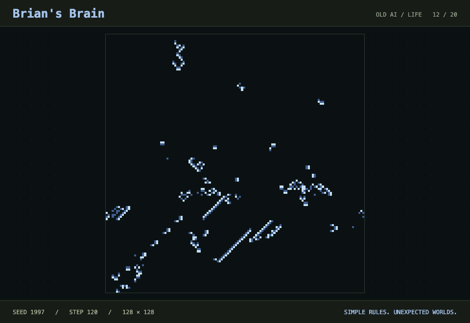</a>
<p>Las células alternan entre reposo, excitación y estado refractario. En la regla clásica, exactamente dos vecinas activas excitan una celda en reposo.</p>
<p><strong>Prueba:</strong> Introduce una chispa o alarga el periodo refractario para crear una variante.</p>
<p><a href="https://www.fourmilab.ch/cellab/manual/ruledef-js.html">Referencia ↗</a></p>
</td>
</tr>
<tr>
<td width="50%" valign="top">
<h3>13 · Piedra, papel, tijera</h3>
<a href="docs/images/cyclic.png">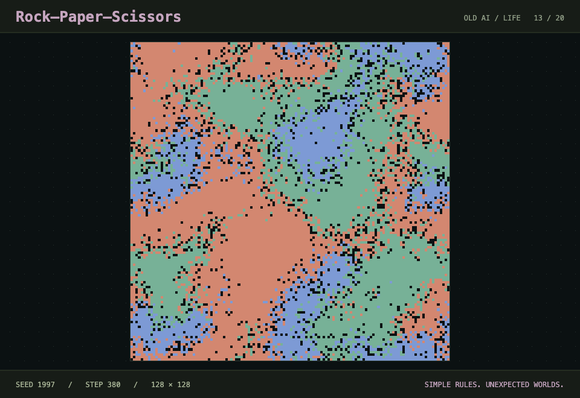</a>
<p>Tres especies compiten en un ciclo: cada una vence a otra y pierde frente a la restante. Selección, reproducción y movimiento transforman los territorios.</p>
<p><strong>Prueba:</strong> Aumenta la movilidad o comienza con tres territorios separados.</p>
<p><a href="https://ccl.northwestern.edu/netlogo/models/RockPaperScissors">Referencia ↗</a></p>
</td>
<td width="50%" valign="top">
<h3>14 · Bosque e incendios</h3>
<a href="docs/images/forest.png">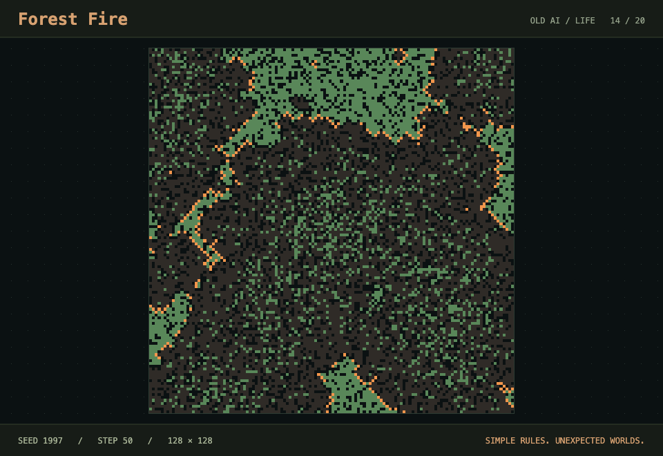</a>
<p>El fuego alcanza los cuatro árboles vecinos y deja ceniza. El rebrote y los rayos opcionales convierten el incendio clásico en un bosque dinámico.</p>
<p><strong>Prueba:</strong> Compara bosques densos y dispersos o dibuja un cortafuegos.</p>
<p><a href="https://ccl.northwestern.edu/netlogo/models/Fire">Referencia ↗</a></p>
</td>
</tr>
<tr>
<td width="50%" valign="top">
<h3>15 · Montículo de arena</h3>
<a href="docs/images/sandpile.png">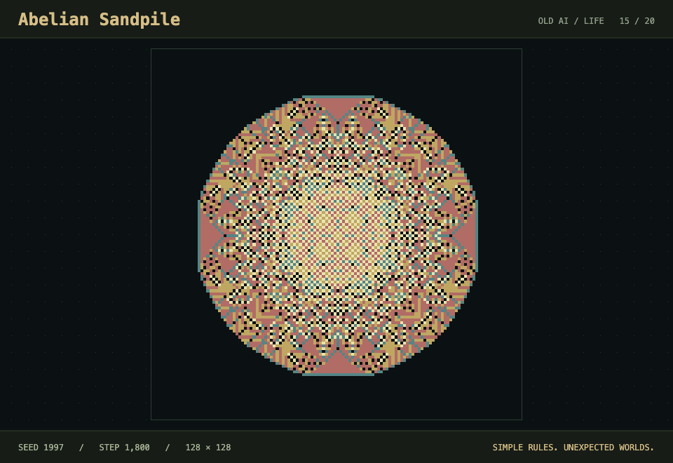</a>
<p>Una celda con cuatro granos o más se derrumba y reparte uno a cada vecino cardinal. Los granos que salen se pierden; el aporte espera a la estabilidad.</p>
<p><strong>Prueba:</strong> Deposita una gran pila central o añade una lluvia lenta y aleatoria.</p>
<p><a href="https://journals.aps.org/prl/abstract/10.1103/PhysRevLett.59.381">Referencia ↗</a></p>
</td>
<td width="50%" valign="top">
<h3>16 · Agregación por difusión · DLA</h3>
<a href="docs/images/dla.png">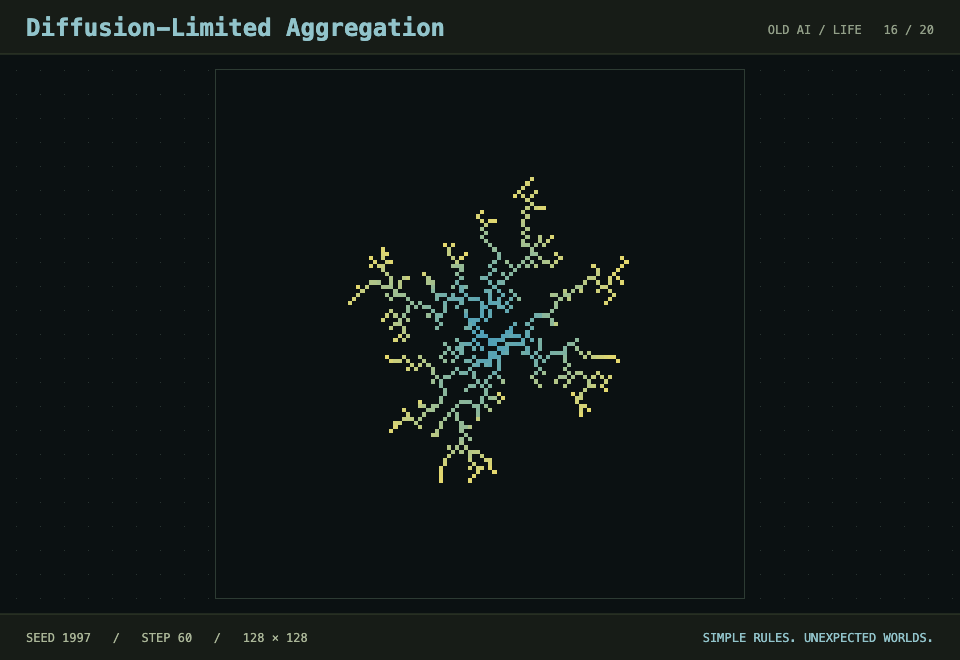</a>
<p>Los caminantes aleatorios se adhieren a un agregado. Las puntas expuestas capturan más partículas que los huecos y producen formas ramificadas.</p>
<p><strong>Prueba:</strong> Compara contactos de cuatro u ocho vecinos o reduce la adhesión.</p>
<p><a href="https://ccl.northwestern.edu/netlogo/models/DLA">Referencia ↗</a></p>
</td>
</tr>
<tr>
<td width="50%" valign="top">
<h3>17 · Agrupación de Schelling</h3>
<a href="docs/images/schelling.png">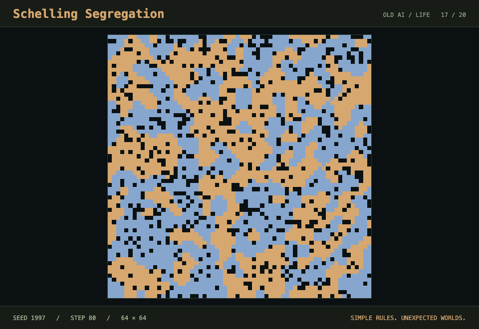</a>
<p>Dos tipos abstractos de agentes se mudan si tienen pocos vecinos de su mismo tipo. Las preferencias locales pueden crear grandes agrupaciones.</p>
<p><strong>Prueba:</strong> Compara la ausencia de preferencia con umbrales moderados y altos.</p>
<p><a href="https://ccl.northwestern.edu/netlogo/models/Segregation">Referencia ↗</a></p>
</td>
<td width="50%" valign="top">
<h3>18 · Circuitos Wireworld</h3>
<a href="docs/images/wireworld.png">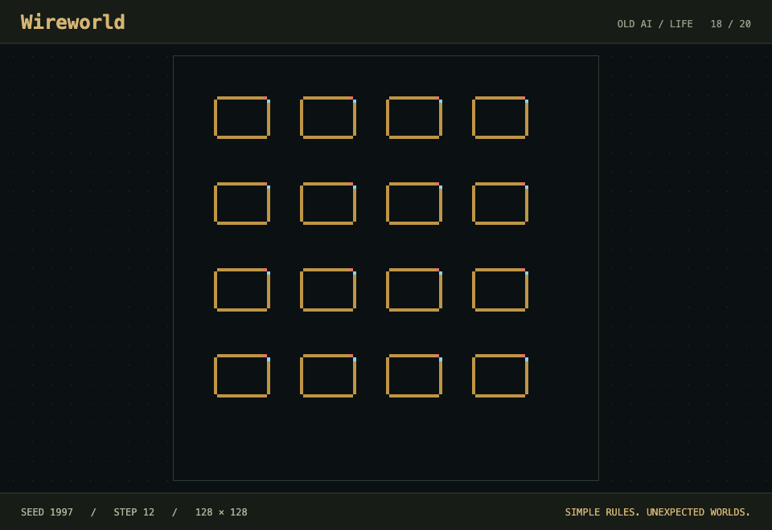</a>
<p>Cuatro estados modelan señales: vacío, conductor, cabeza y cola de electrón. Reglas locales permiten que los pulsos recorran los circuitos dibujados.</p>
<p><strong>Prueba:</strong> Construye un cable o un bucle y coloca una cabeza seguida de una cola.</p>
<p><a href="https://wireworld.co/">Referencia ↗</a></p>
</td>
</tr>
<tr>
<td width="50%" valign="top">
<h3>19 · Luciérnagas de Kuramoto</h3>
<a href="docs/images/fireflies.png">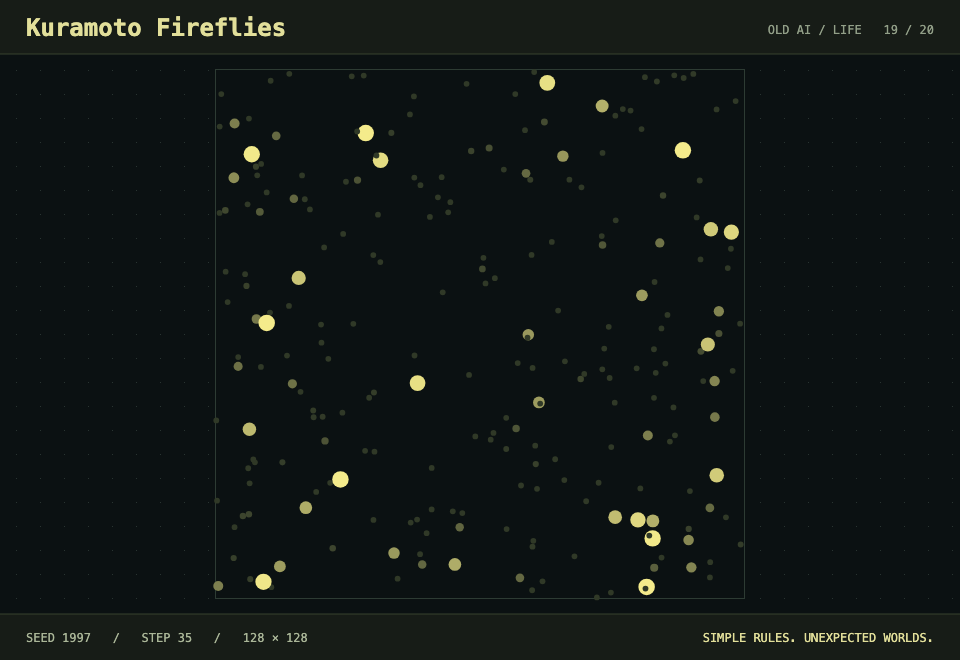</a>
<p>Osciladores de fase acoplados globalmente se muestran como luces intermitentes. El parámetro de orden mide la coincidencia de sus fases.</p>
<p><strong>Prueba:</strong> Desactiva el acoplamiento y después auméntalo para observar la sincronización.</p>
<p><a href="https://pmc.ncbi.nlm.nih.gov/articles/PMC3532102/">Referencia ↗</a></p>
</td>
<td width="50%" valign="top">
<h3>20 · Jardín de sistemas L</h3>
<a href="docs/images/lsystem.png">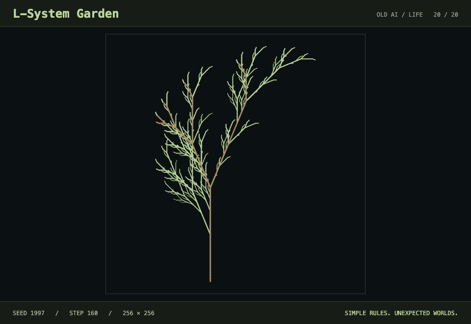</a>
<p>La reescritura paralela expande una gramática y una tortuga interpreta sus símbolos como ramas y giros. La animación revela la geometría resultante.</p>
<p><strong>Prueba:</strong> Edita las producciones F/X, el ángulo de ramificación y las generaciones.</p>
<p><a href="https://www.algorithmicbotany.org/papers/abop/abop-ch1.lowquality.pdf">Referencia ↗</a></p>
</td>
</tr>
</table>
## Usar el laboratorio

| Control | Qué hace |
| --- | --- |
| Filtros y pestañas | Cambian de experimento. Cada pestaña conserva su mundo; solo avanza la activa. |
| **Punto de partida** | Carga un ejemplo. Algunos incluyen pasos iniciales precalculados, indicados en el contador. |
| **Iniciar / Pausar**, paso y reinicio | Ejecutan continuamente, avanzan un paso o reinician con los parámetros y la semilla elegidos. |
| **VELOCIDAD** | Solicita entre 1 y 10.000 pasos/s. La velocidad real depende del modelo y del equipo. |
| **EN VIVO** | Aplica el parámetro al mundo existente. |
| **INICIO** | Prepara un cambio; **Aplicar y reiniciar** reconstruye el mundo. |
| Pinceles | Añaden organismos, materia y recursos; borran celdas o ejecutan acciones del modelo. |
| **Guardar aquí** | Guarda en IndexedDB del navegador; el mundo activo se autoguarda cada 20 segundos. |
| **Exportar / Importar JSON** | Traslada el estado completo, incluidos parámetros, semilla y generador aleatorio. |
| **Captura PNG** | Descarga la vista actual del mundo. |

**Atajos:** `Espacio` pausa o continúa, `N` avanza un paso, `R` reinicia y `F` ajusta la vista. Con el foco en las pestañas, `←` / `→`, `Inicio` y `Fin` recorren la familia actual. `Mayúsculas` + arrastrar desplaza; `Ctrl` / `Cmd` + rueda cambia el zoom.

El guardado pertenece a un origen concreto: `localhost`, `127.0.0.1` y distintos puertos tienen almacenamientos separados. Usa JSON para trasladar experimentos. Las gráficas empiezan de nuevo al cargar. El navegador puede reducir la actividad de pestañas en segundo plano.

### Cómo interpretar lo que ves

- **La coexistencia es un resultado, no una garantía.** Las especies pueden extinguirse; no se repueblan silenciosamente para mantener actividad.
- **El orden y las fronteras importan.** Algunos mundos conectan sus bordes; la arena pierde granos por ellos y DLA se detiene antes de alcanzarlos.
- **Acelerar no agranda el paso numérico.** Se calculan más pasos de simulación.
- **Las variantes están identificadas.** Las notas distinguen reglas clásicas, adaptaciones y configuraciones experimentales.
- **El tiempo significa cosas distintas en cada modelo.** Los sistemas L revelan segmentos de una generación; las luciérnagas visualizan osciladores. No son predicciones biológicas.

Abre **Ver detalles** en el cuaderno de cada modelo para consultar decisiones de implementación y fuentes.

## Cómo está construido

**TypeScript + Vite + Canvas 2D + un Web Worker.** El worker calcula las simulaciones; el hilo principal gestiona los controles, el dibujo y las gráficas. No hay backend, base de datos remota ni framework de interfaz en ejecución.

```text
src/
  catalog.ts, catalog-extra.ts   Descripciones, controles y ejemplos
  models/                       Veinte motores de simulación
  core/                         Estado, aleatoriedad, índice espacial y FFT
  worker.ts                     Ejecución y mensajes
  render.ts                     Mundos Canvas y gráficas
  main.ts, style.css            Interfaz y diseño retro
  storage.ts                    Guardado local en IndexedDB
  data/orbium.json               Patrón Lenia con atribución
scripts/                        Benchmark y generación reproducible de imágenes
tests/                          Reglas, invariantes, persistencia e integración
docs/                           Referencias, verificación e imágenes
```

Los motores usan arrays tipados para los campos, índices espaciales para ciertas interacciones entre agentes y convolución FFT para Lenia. Todos disponen de estado serializable y aleatoriedad con semilla.

## Desarrollo

```sh
npm test                 # Reglas, invariantes, persistencia y Worker
npm run build            # Comprobación de tipos y compilación
npm run benchmark        # 1.000 pasos por modelo; escribe docs/benchmark.json
npm run screenshots      # Regenera las 20 imágenes y la portada
npm run format           # Formatea código, pruebas y scripts
```

La suite actual tiene **53 pruebas aprobadas**: patrones celulares conocidos, reproducción y hambre, conservación de masa, ocupación de Physarum, señales Wireworld, sincronización de Kuramoto, gramáticas y continuidad exacta tras restaurar JSON. GitHub Actions ejecuta las pruebas y la compilación en cada push y pull request.

El benchmark mide cálculo del motor en Node, **no FPS del navegador**. DLA y los sistemas L apenas trabajan cuando han completado su desarrollo; los pasos posteriores no representan velocidad de crecimiento activo. Las pruebas verifican los comportamientos comprobados, no estabilidad universal ni fidelidad científica completa.

## Colaborar

Se aceptan issues y pull requests en **inglés o español**. Puedes aportar modelos, ejemplos, traducciones, mejoras de accesibilidad o rendimiento.

Consulta [CONTRIBUTING.md](CONTRIBUTING.md), en inglés. Para un error, incluye modelo, semilla, configuración y, si es posible, una partida exportada. [Abrir una incidencia](https://github.com/FernandoOleaDev/OldAiLife/issues).

## Créditos y referencias

Este proyecto parte de ideas de Christopher Langton, John Horton Conway, Stephen Wolfram, Craig Reynolds, A. K. Dewdney, Uri Wilensky y la comunidad NetLogo, Bert Chan, Jeff Jones, Brian Silverman, Bak–Tang–Wiesenfeld, Witten–Sander, Thomas Schelling, Yoshiki Kuramoto, Aristid Lindenmayer, Przemysław Prusinkiewicz y otros investigadores e implementadores enlazados en cada modelo.

Los motores están escritos para este proyecto. El **patrón Orbium O2u** deriva del [catálogo Lenia de Bert Chan](https://github.com/Chakazul/Lenia); se conservan su [aviso MIT](docs/LENIA_LICENSE.md) y el [registro de procedencia](docs/lenia-provenance.json). NetLogo se utiliza como referencia conceptual: su código fuente no se ha copiado en la aplicación.

Más información: [decisiones de implementación y referencias](docs/IMPLEMENTACION.md), [alcance de la verificación](docs/VERIFICACION.md) y [plan de investigación inicial](PLAN_INICIAL.md).

## Licencia

[MIT](LICENSE) © 2026 Fernando Olea. El material de terceros conserva sus propias atribuciones y avisos de licencia.
